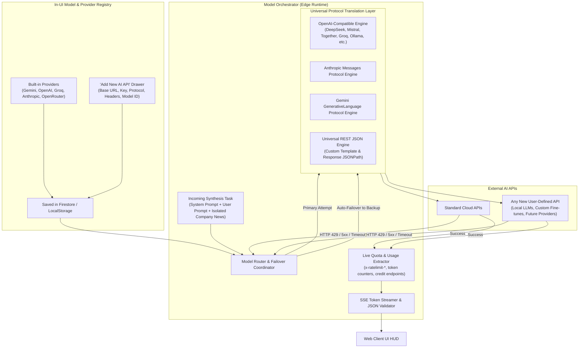

# News Tracker: Architecture & Implementation Plan

A comprehensive, extensible corporate news intelligence platform designed for **Cloudflare Free Plan** and **Firebase Free Plan**, featuring universal data source aggregation, a dynamic **Model Orchestrator** capable of ingesting any new AI APIs on the fly, strict company data isolation, password-only authentication, in-UI API key management with live connection testing, live usage tracking, advanced multi-strategy web scrapers, and client-side executive PDF generation.

---

## 1. Goal Description

Build **NewsTracker** — an end-to-end, privacy-respecting news tracking and synthesis system with:

1. **Universal Data API Aggregator & Advanced Scraper Engine**:
   - Pluggable, extensible framework capable of ingesting from **any data API or source** (REST endpoints, custom financial feeds, NewsAPI, Finnhub, GNews, AlphaVantage, Polygon, Reddit/HackerNews, Google News RSS, or custom user-configured API endpoints).
   - **Advanced Multi-Strategy Web Scraper Engine**:
     - *Strategy A (Direct Smart Fetch)*: Rotating browser-grade headers, user-agents, TLS/Sec-Ch-Ua spoofing, handling redirects and gzip/brotli decoding to bypass basic anti-bot blocks.
     - *Strategy B (Structured JSON-LD & OpenGraph Extractor)*: Parses `schema.org/NewsArticle` and `schema.org/Report` which publishers embed for search indexing—extracting pure `articleBody`, bylines, and publish timestamps without ad clutter.
     - *Strategy C (Semantic DOM Readability)*: Heuristic text-to-tag density scoring, automatically stripping paywall popups, cookie consent banners, navbars, and advertisements.
     - *Strategy D (Edge Reader Fallback)*: Automatic proxy fallback (e.g. Jina Reader `r.jina.ai/{url}`) if an upstream domain triggers a 403/Cloudflare challenge.
     - *Domain Concurrency & Smart Cache*: Domain-level rate-limiting queue and caching in KV/Firestore so the same article is never re-scraped.
   - Multi-stage pipeline: Schema normalization, URL cleaning, multi-level deduplication (exact hash + semantic/fuzzy headline distance), source credibility scoring, zero-data-loss buffering, and **strict entity isolation** ensuring each tracked company receives distinct, non-overlapping news payloads.

2. **Model Orchestrator (Dynamic Multi-Provider AI Engine)**:
   - Capable of connecting to and orchestrating **any existing or future AI API**:
     - **Pre-configured Adapters**: Google Gemini, OpenAI, Anthropic, Groq, OpenRouter.
     - **Dynamic Custom AI API Engine**: Allows the user to register *any* new AI provider endpoint on the fly from the UI (OpenAI-compatible endpoints, custom REST LLM APIs, DeepSeek, Mistral, Together AI, Perplexity, or self-hosted Ollama/vLLM) with zero code modifications.
   - **Smart Failover & Fallback Pool**: User-ordered fallback chain (e.g. Primary Model -> Fallback Model 1 -> Fallback Model 2) that automatically catches HTTP 429 rate limits, timeouts, or quota exhaustion and smoothly fails over.
   - **Real-Time Streaming Synthesis (SSE)**: Streams generated intelligence live with Markdown formatting and typewriter effects.
   - **Cross-Company Ecosystem Impact Matrix**: High-level cross-impact analysis without duplicating or overlapping company-specific news.
   - **Critical Event & Breaking News Badges**: Real-time tagging of high-volatility events (CEO turnover, SEC investigations, M&A, lawsuits).
   - **Real-Time Dynamic Usage Meter**: Parses live quota and usage directly from API response headers (e.g. `x-ratelimit-remaining-tokens`, `x-ratelimit-remaining-requests`) and account endpoints (e.g. OpenRouter credit endpoint) without any hardcoded mock numbers.

3. **In-UI API Key Management & Live Connection Testing**:
   - Seamless settings drawer in the UI allowing the user to **input, update, and manage all API keys directly from the browser** (Data API keys, AI provider keys, custom endpoint tokens).
   - Zero requirement to manually configure Cloudflare secrets or redeploy when rotating keys.
   - Dual-persistence choice: Persist encrypted in the user's private Firestore document (synced across devices upon password login) or session-only in `localStorage`.
   - Real-time "Test Connection" button per key: Immediately pings the provider to verify validity, latency, and live quota balance.

4. **Meticulous yet Minimalist User Interface**:
   - **Password-Only Sign-In**: UI displays **only a single Password input** (no email field, no signup flow). Under the hood, this binds to the manually created Firebase credentials.
   - **Company Management**: Dedicated tag/pill interface for adding/editing tracked companies and saving watchlists.
   - **Prompt Studio**: Textarea for custom prompts with "Save as preset" (persisted to Firestore) vs "One-time run" toggle.
   - **Live HUD Usage Meter**: Visual indicators displaying real-time remaining tokens/requests per provider.
   - **Report Snapshot History & Offline Caching**: Persists runs to Firestore/IndexedDB to view previous briefs and re-export without burning tokens.
   - **Interactive PDF Customizer & Generator**: Configurable corporate PDF export (toggle sections: Summary, Impact Matrix, Per-Company Breakdowns, Citations).

5. **100% Free-Tier Cloud Deployment**:
   - **Cloudflare Pages & Edge Functions**: Hosting and edge API routing with zero server costs.
   - **Cloudflare Cron Triggers**: Automated daily briefings (e.g. 7:00 AM UTC) delivered into Firestore.
   - **Firebase Free (Spark)**: Secure Auth and Firestore database for user presets, watchlists, API key storage, and report archives.

---

## 2. Deep Dive: Model Orchestrator & Handling New AI APIs

The **Model Orchestrator** is built from the ground up to handle **any new AI API** dynamically, without code changes or redeployments:



### 2.1. How New APIs Are Configured in the UI:
The UI includes a dedicated **"Add Custom AI Model / API"** interface:
- **Provider Label**: Name for the provider (e.g. *"DeepSeek-V3"*, *"Local Ollama"*, *"Internal FinLLM"*).
- **API Base URL**: Full endpoint base URL (e.g. `https://api.deepseek.com/v1`, `http://localhost:11434/v1`, or a custom gateway).
- **API Key / Bearer Token**: Provided directly in the UI.
- **Protocol Type**:
  - `openai-compatible`: Covers 90%+ of all new providers (DeepSeek, Together AI, Perplexity, Mistral, vLLM, Ollama, Anyscale, Fireworks).
  - `anthropic-messages`: For Claude-compatible endpoints.
  - `gemini-v1`: For Google Generative AI endpoints.
  - `generic-rest`: For proprietary endpoints with custom JSON body templates.
- **Model ID**: The specific model string (e.g. `deepseek-chat`, `llama3.3:70b`, `claude-3-5-sonnet-20241022`).
- **Quota Header Names (Optional)**: Header keys to parse for live usage (e.g. `x-ratelimit-remaining-tokens`).

### 2.2. Model Orchestrator Execution Flow:
1. **Compilation**: The orchestrator merges the system analyst instructions, the user prompt, and the unique non-overlapping news articles for each company into a prompt payload.
2. **Dynamic Adapter Selection**: The orchestrator inspects the active provider configuration. If it's a built-in provider, it uses the native adapter; if it's a custom endpoint, it binds the `UniversalOpenAICompatibleAdapter` or `GenericRestAdapter`.
3. **Execution with Auto-Fallback**:
   - The primary model is invoked.
   - If the upstream provider returns `429 Too Many Requests`, `503 Service Unavailable`, or connection timeout, the orchestrator instantly catches the error, logs the failover event, and executes against the designated secondary fallback model.
4. **Live Usage Telemetry Extraction**:
   - Captured HTTP headers (`x-ratelimit-remaining-tokens`, `x-ratelimit-remaining-requests`) and body token counts are extracted directly and returned in real-time.
5. **Streaming Output (SSE)**:
   - Output tokens stream live to the client using Server-Sent Events, rendering in real-time.

---

## 3. Universal Extensibility Matrix

| Layer / Subsystem | How It Is Made 100% Extensible for Future Additions | Future Additions Possible With Zero Core Changes |
| :--- | :--- | :--- |
| **Model Orchestrator & AI APIs** | Pluggable `IAIProviderAdapter` and `UniversalOpenAICompatibleAdapter`. Dynamic registration in the UI allows adding *any* new AI provider on the fly. | Add DeepSeek, Mistral, Together AI, Perplexity, Local Ollama, fine-tuned models, or future LLM architectures. |
| **Data Sources & Ingestion** | Adapter interface `IDataSourceAdapter`. Any new source simply implements `fetchCompanyNews(company, options)`. | Add new news/market APIs, WebSocket feeds, scraping targets, regulatory filings. |
| **Web Scraper Engine** | Waterfall strategy array `ScraperStrategy[]`. New strategies can be appended into the execution chain with a single line. | Add stealth proxies, CAPTCHA solvers, archive.org fallbacks, or audio/video podcast transcript extractors. |
| **In-UI Key Management** | Dynamic Key Schema Registry. Adding a new provider key field only requires a config entry `{ id, label, defaultBaseUrl, docLink }`. | Add any new AI or Data API keys directly in the UI settings screen without schema migrations. |
| **Analysis & Pipeline Middleware** | Interceptor pipeline: `Article[] -> Normalizer -> Scraper -> PipelineInterceptors[] -> AI -> OutputTransformers[]`. | Add automated translation, sentiment models, financial ratio calculators, vector embeddings for RAG, or SEC financial table parsers. |
| **User Interface & Views** | Component-driven registry with modular panels. State is managed via typed reactive stores decoupled from presentation. | Add financial stock charts (TradingView / Lightweight Charts), Dark/Light/Terminal modes, Kanban boards, or custom company comparison widgets. |
| **Export & Integrations** | Strategy-based exporters (`IReportExporter`). | Add CSV, Excel (.xlsx), Notion database sync, Google Drive upload, Discord/Slack webhooks, or Email dispatch. |
| **Database & Auth** | Abstract repository interfaces (`IAuthService`, `IDatabaseService`). Firebase is currently implemented, but fully swappable. | Migrate or hybridize with Cloudflare D1 (SQL), KV, Supabase, PostgreSQL, or hardware Passkeys / WebAuthn. |

---

## 4. High-Level Architecture Diagram

```mermaid
flowchart TD
    subgraph Client["Web Client (Cloudflare Pages SPA)"]
        UI["Minimalist UI (React + Tailwind + Lucide)"]
        AuthModule["Password-Only Auth Guard\n(Firebase Auth behind single password input)"]
        ApiKeyDrawer["In-UI API Key Manager & Live Ping Tester"]
        ModelConfigDrawer["Model Orchestrator Manager\n(Register New AI APIs, Set Fallbacks)"]
        CompanyInput["Company Tagger UI"]
        PromptDrawer["Prompt Composer (Preset vs One-off)"]
        UsageHUD["Live Provider Usage Meter (Headers & Balance)"]
        HistoryDrawer["Report History & Offline Snapshots"]
        PDFGen["Client-Side PDF Generator & Customizer"]
    end

    subgraph FirebaseServices["Firebase Free (Spark Tier)"]
        FBAuth["Firebase Authentication\n(Pre-configured admin user)"]
        Firestore["Cloud Firestore\n(Saved Prompts, Watchlists, Stored API Keys, Custom Models, Report Snapshots)"]
    end

    subgraph CloudflareEdge["Cloudflare Edge API (/api/*)"]
        APIGateway["Edge Router (Hono / Functions)"]
        CronTrigger["Scheduled Cron Trigger\n(0 7 * * * Daily Briefing)"]

        subgraph UniversalDataAggregator["1. Universal Data API Aggregator"]
            SourceRegistry["Pluggable Source Registry\n(Built-in + Custom User Endpoints)"]
            Normalizer["Universal Schema Normalizer"]
            Deduplicator["Deduplication Engine\n(URL Canonicalizer + Title Fuzzy Hash)"]
            CredibilityScorer["Credibility & Provenance Scorer"]
            EntityPartitioner["Company Isolation Engine\n(Strict Non-Overlapping Guarantee)"]
            
            subgraph AdvancedScraperEngine["Advanced Web Scraper Engine"]
                SmartFetcher["Smart Fetcher\n(Rotating Headers, Anti-Bot TLS Spoofing)"]
                JsonLdExtractor["JSON-LD & OpenGraph Extractor\n(schema.org/NewsArticle body parser)"]
                DomReadability["Semantic DOM Readability\n(Text density scoring & cleanup)"]
                ReaderProxy["Edge Reader Fallback\n(Jina Reader r.jina.ai proxy)"]
                DomainThrottler["Domain Concurrency Throttler & KV Cache"]
            end
        end

        subgraph UniversalModelOrchestrator["2. Universal Model Orchestrator"]
            ProviderRegistry["Pluggable AI Provider Registry\n(Gemini, OpenAI, Groq, OpenRouter, ANY New Custom Endpoints)"]
            Router["Model Router & Auto-Failover Engine"]
            PromptCompiler["Prompt Assembler\n(User Prompt + Data Schema)"]
            UsageExtractor["Live Quota & Header Extractor\n(x-ratelimit-* and usage endpoints)"]
            StreamSynthesizer["Real-Time Token Streamer (SSE)\n(Typewriter markdown rendering)"]
            ImpactMatrixEngine["Cross-Company Impact Matrix Engine"]
        end
    end

    subgraph ExternalSources["External Data & AI APIs"]
        AnyDataAPIs["Any Data API\n(Finnhub, NewsAPI, GNews, RSS, Custom REST APIs)"]
        PublisherSites["Target News Publishers\n(Scraped Web Articles)"]
        AnyAIProviders["Any AI Provider\n(Gemini, OpenAI, Groq, Anthropic, OpenRouter, Local/Custom New APIs)"]
    end

    UI --> AuthModule
    AuthModule --> FBAuth
    UI --> Firestore
    UI --> ApiKeyDrawer
    UI --> ModelConfigDrawer
    UI --> APIGateway
    CronTrigger --> APIGateway
    
    APIGateway --> UniversalDataAggregator
    UniversalDataAggregator --> AnyDataAPIs
    UniversalDataAggregator --> AdvancedScraperEngine
    AdvancedScraperEngine --> PublisherSites
    UniversalDataAggregator --> UniversalModelOrchestrator
    UniversalModelOrchestrator --> AnyAIProviders
    UniversalModelOrchestrator --> UsageExtractor
    UsageExtractor --> UsageHUD
    UniversalModelOrchestrator --> StreamSynthesizer
    StreamSynthesizer --> UI
    UI --> PDFGen
    UI --> HistoryDrawer
```



---

## 5. Password-Only Sign-In Specification

- **Screen Layout**:
  - Pure minimalist dark/light container centered on the screen.
  - Title: `NewsTracker` with subtle status dot.
  - Subtitle: `Enter access password to continue`.
  - Single input field: `<input type="password" placeholder="Access Password" autoFocus />`.
  - Submit button: `Authenticate →`.
- **Under the Hood**:
  - The single administrative user is created in the Firebase Authentication Console with email (e.g. `admin@newstracker.internal`) and your desired password.
  - When you submit the password on the UI, the client runs:
    ```typescript
    await signInWithEmailAndPassword(auth, ADMIN_ACCOUNT_EMAIL, inputPassword);
    ```
  - Zero signup pages, zero registration endpoints, zero email input fields exposed.

---

## 6. Proposed Changes & Implementation Files

Grouped by component layer:

### 6.1. Core Project Configuration & Tooling
#### [NEW] `package.json`
- Dependencies: React 19, TypeScript, Vite, Tailwind CSS, Lucide React, Hono (for Cloudflare Functions), Firebase (v10+), jsPDF, jsPDF-autotable, Zod (schema validation), Vitest (testing).
#### [NEW] `vite.config.ts`
- Fast build configuration, path aliases (`@/*`), proxy settings for local edge function testing.
#### [NEW] `tailwind.config.js`
- Minimalist palette (slate, zinc, subtle obsidian, refined border colors, modern sans fonts).
#### [NEW] `wrangler.toml`
- Cloudflare Pages configuration, environment variables, compatibility flags, cron triggers.

---

### 6.2. Component 1: Universal Data API Aggregator & Advanced Scraper Engine
Location: `functions/api/aggregators/data/`

#### [NEW] `types.ts`
- Canonical schemas: `CanonicalArticle`, `IDataSourceAdapter`, `DataSourceConfig`, `AggregationFilter`, and `CompanyPartitionResult`.
#### [NEW] `normalizer.ts`
- Standardizes diverse API payloads into clean `CanonicalArticle` records.
#### [NEW] `deduplicator.ts`
- URL canonicalizer (removes tracking parameters).
- SHA-256 fingerprinting.
- Levenshtein & Jaccard token similarity (>80% overlap threshold) to eliminate syndicated wire duplicates.
#### [NEW] `partitioner.ts`
- Entity isolation engine: Enforces the **strict non-overlapping company guarantee**. Evaluates entity salience, partitions multi-entity mentions, and assigns stories exclusively to distinct company buckets.
#### [NEW] `credibility.ts`
- Domain reputation weighting table (Tier 1 financial press, news wires, regulatory filings vs unverified blogs).
- Freshness and timestamp validation.
#### [NEW] `scraper/smart-fetch.ts`
- Strategy A: Modern Chrome HTTP/2 request profile (`sec-ch-ua`, gzip/brotli, redirect tracing).
#### [NEW] `scraper/jsonld-parser.ts`
- Strategy B: Parses `schema.org/NewsArticle` and `schema.org/Report` extracting clean `articleBody` without ad noise.
#### [NEW] `scraper/readability.ts`
- Strategy C: Semantic DOM text-to-tag density scoring, stripping cookie banners and paywall overlays.
#### [NEW] `scraper/reader-proxy.ts`
- Strategy D: Jina Reader fallback (`r.jina.ai/{url}`) for 403 / anti-bot challenges.
#### [NEW] `scraper/throttler.ts`
- In-memory per-domain concurrency limiter and KV caching.
#### [NEW] `scraper/scraper-engine.ts`
- Waterfall controller managing the 4 strategies with fallback execution.
#### [NEW] `adapters/`
- `base-adapter.ts`: Abstract base adapter with retry logic and error handling.
- `google-rss.ts`: Google News Corporate RSS parser (free, no API key).
- `finnhub.ts`: Finnhub corporate news adapter.
- `newsapi.ts`: NewsAPI adapter.
- `gnews.ts`: GNews adapter.
- `generic-rest.ts`: Universal REST adapter allowing any user-defined API endpoint with configurable field mapping.
#### [NEW] `index.ts`
- Main aggregator entrypoint: Concurrently triggers active adapters, runs the scraper engine, executes deduplication, enforces company isolation, and returns partitioned news bundles.

---

### 6.3. Component 2: Model Orchestrator & Live Usage Meter
Location: `functions/api/aggregators/ai/`

#### [NEW] `types.ts`
- Interfaces for `AIProviderConfig`, `IAIProviderAdapter`, `SynthesisRequest`, `SynthesisResponse`, `ModelFailoverPolicy`, and `ProviderQuotaTelemetry`.
#### [NEW] `usage-tracker.ts`
- Header and endpoint extractor: Reads live `x-ratelimit-*`, token counts, and provider balance endpoints directly from incoming responses.
#### [NEW] `prompt-assembler.ts`
- Compiles:
  - System Analyst instruction (strict financial & business acumen, citation formatting, JSON output format).
  - User custom prompt (one-off or preset).
  - Company roster and company-isolated news payload.
#### [NEW] `stream-handler.ts`
- Server-Sent Events (SSE) live token streamer with real-time typewriter emission.
#### [NEW] `matrix-engine.ts`
- Cross-company ecosystem impact synthesis engine.
#### [NEW] `adapters/`
- `gemini.ts`: Google Gemini adapter with usage metadata extraction.
- `openai.ts`: OpenAI adapter with rate-limit header parsing.
- `groq.ts`: Groq adapter with token rate-limit header parsing.
- `openrouter.ts`: OpenRouter adapter with live credit API query.
- `generic-openai.ts`: **Universal Adapter for Any New AI API** (DeepSeek, Mistral, Together AI, Local Ollama, vLLM, custom endpoints).
#### [NEW] `orchestrator.ts`
- Central Model Orchestrator: Dynamic routing across built-in and user-registered AI APIs, auto-failover on 429/5xx, structured output verification (Zod), and quota telemetry packaging.

---

### 6.4. Component 3: Cloudflare Edge Routing & Cron Scheduling
Location: `functions/api/`

#### [NEW] `[[routes]].ts`
- Hono edge app defining API endpoints:
  - `POST /api/news/aggregate`: Ingests company list, runs Data Aggregator, returns isolated articles.
  - `POST /api/ai/synthesize`: Runs Model Orchestrator on isolated articles with prompt, returns structured analysis and live usage telemetry.
  - `POST /api/ai/synthesize/stream`: SSE streaming synthesis endpoint.
  - `GET /api/ai/usage`: Direct endpoint to check current provider quota/credits.
  - `POST /api/sources/test`: Tests a custom user-defined data or AI endpoint.
#### [NEW] `scheduled/daily-briefing.ts`
- Cloudflare Cron Trigger (7:00 AM UTC): Automatically runs default watchlist and stores briefing in Firestore.

---

### 6.5. Component 4: Frontend UI (Meticulous Minimalist)
Location: `src/`

#### [NEW] `components/auth/PasswordSignIn.tsx`
- Minimalist, distraction-free sign-in card.
- Single **Password** input field (no email input, no signup flow).
- Under the hood connects to Firebase Auth with pre-provisioned credentials.
#### [NEW] `components/settings/ApiKeySettingsModal.tsx`
- In-UI API Key Manager & Live Ping Tester: Allows entering keys for any data API or AI provider with instant connection check.
#### [NEW] `components/settings/ModelOrchestratorModal.tsx`
- **Dynamic AI Model Registry**: UI to add any new AI API endpoint (name, base URL, key, protocol, model ID) and configure the failover order.
#### [NEW] `components/common/Navbar.tsx`
- Minimalist header with live provider badge, settings trigger, report history trigger, and live usage telemetry meter.
#### [NEW] `components/common/LiveUsageMeter.tsx`
- Real-time gauge/progress bar displaying remaining tokens, remaining requests, and reset timers directly from provider data.
#### [NEW] `components/common/ReportHistoryDrawer.tsx`
- Slide-out drawer displaying past briefing snapshots loaded from Firestore without spending tokens.
#### [NEW] `components/companies/CompanyTagger.tsx`
- Clean tag/chip input for adding company names/tickers (Enter, comma, or bulk paste).
- Watchlist dropdown to save and load company groups from Firestore.
#### [NEW] `components/prompts/PromptStudio.tsx`
- Custom prompt composer with preset selector.
- Toggle for "Save as preset to Firestore" vs "Single-use run".
#### [NEW] `components/results/ExecutiveReportView.tsx`
- Global Executive Summary across all tracked companies.
- Ecosystem impact matrix.
- Accordion/Tab panels for each company displaying:
  - Strict non-overlapping highlights.
  - Sentiment gauge (-1.0 to +1.0).
  - Key business catalysts & risk warnings.
  - Verified source references with credibility badges.
#### [NEW] `components/results/StreamingReportView.tsx`
- Real-time typewriter rendering view for live SSE synthesis.
#### [NEW] `components/results/ImpactMatrixTable.tsx`
- Cross-company ripple effect matrix.
#### [NEW] `components/results/CriticalEventBadge.tsx`
- High-impact tags for regulatory, M&A, and leadership disruptions.
#### [NEW] `components/results/PdfCustomizerModal.tsx`
- Modal allowing users to toggle sections before generating the PDF report.
#### [NEW] `lib/pdf-generator.ts`
- Client-side `jspdf` engine creating a clean, corporate PDF report with table of contents, company breakdowns, and clickable citations.
#### [NEW] `lib/key-store.ts`
- Client-side encryption and storage manager for API keys and custom model definitions.
#### [NEW] `lib/firebase.ts` & `lib/firestore-service.ts`
- Firebase client initialization, saved prompt presets CRUD, watchlist CRUD, and report snapshots.
#### [NEW] `App.tsx`
- Auth state observer and main application dashboard.

---

## 7. Verification Plan

### Automated Tests
Run automated test suite:
```bash
npm run test
```
The test suite will verify:
1. **Model Orchestrator & New AI APIs**:
   - Tests registering a dynamic OpenAI-compatible endpoint with custom URL and token.
   - Tests automatic failover: Primary model returns 429; orchestrator seamlessly switches to secondary model and finishes synthesis.
   - Tests quota header extraction (`x-ratelimit-remaining-tokens`) with zero hardcoded values.
2. **In-UI Key Handling & Test Ping**:
   - Tests ping validation endpoint with mock provider keys.
   - Verifies fallback hierarchy (client key > environment secret).
3. **Advanced Scraper Waterfall**:
   - Tests JSON-LD extraction against simulated publisher HTML.
   - Tests DOM readability heuristic to ensure ad banners and navigation bars are stripped.
   - Tests Jina Reader fallback when encountering simulated 403 status.
   - Tests per-domain concurrency limiter.
4. **Deduplication Engine**:
   - Ingests multiple URLs with tracking query parameters pointing to the same article; confirms they merge into a single canonical record.
   - Tests headline fuzzy matching (wire syndications) to verify duplicate elimination.
5. **Company Isolation Engine**:
   - Ingests cross-company stories (e.g. "Apple and Microsoft enter AI agreement"); validates that each company receives a unique, non-overlapping contextual extract with zero duplicate article records across company buckets.
6. **Universal REST Data Adapter**:
   - Simulates custom REST data API ingestion and validates canonical schema transformation.

### Manual Verification
1. **Password-Only Sign-In**:
   - Navigate to the app; confirm that only a password input is presented (no email field, no signup buttons).
   - Enter an incorrect password; verify that a clean error message appears.
   - Enter the valid password; confirm immediate transition to the workspace.
2. **Model Orchestrator: Register a New AI API**:
   - Open Model Settings; click "Add New AI API".
   - Enter a custom endpoint (e.g. DeepSeek or Ollama URL + key).
   - Click "Test Connection": confirm real-time validation badge and latency ping.
   - Set as primary model. Run synthesis; verify that the custom API processes the request.
3. **In-UI API Key Manager**:
   - Enter data and AI keys in settings. Save and verify persistence across reloads.
4. **Company Tagging & Watchlists**:
   - Enter multiple companies (e.g., `NVIDIA`, `Apple`, `Tesla`).
   - Save as a watchlist named "Tech Giants"; refresh the page and verify that the watchlist reloads from Firestore.
5. **Live Streaming AI Synthesis**:
   - Run synthesis. Verify that tokens stream in live with a typewriter effect.
   - Verify that news articles under `Apple` are distinct from `NVIDIA` and `Tesla` (no duplicate/overlapping stories).
   - Verify that the Live Usage Meter HUD in the navbar immediately updates with the exact remaining tokens/requests reported by the provider.
6. **Cross-Company Impact Matrix**:
   - Confirm the impact table renders clearly showing cross-entity implications.
7. **Report History Drawer**:
   - Open history drawer; confirm current report appears; reload a past report with zero API calls.
8. **Customizable PDF Export**:
   - Click "Download PDF"; customize toggles in the modal; generate and verify clean layout, vector fonts, and clickable citations.

---

## 8. Deployment Guide (Cloudflare & Firebase Free Tiers)

1. **Firebase Setup**:
   - Create a free Firebase project (Spark Tier).
   - Enable **Firebase Authentication** (Email/Password provider).
   - Manually create the single user account in the Firebase Console (e.g. `admin@newstracker.internal` with your chosen password).
   - Enable **Cloud Firestore** in production mode with user-restricted rules.
2. **Cloudflare Pages Setup**:
   - Connect the repository to Cloudflare Pages.
   - Build settings:
     - Framework: Vite
     - Build command: `npm run build`
     - Output directory: `dist`
3. **Local Development**:
   - Run `npm install`
   - Run `npm run dev` to start Vite with local edge functions.
